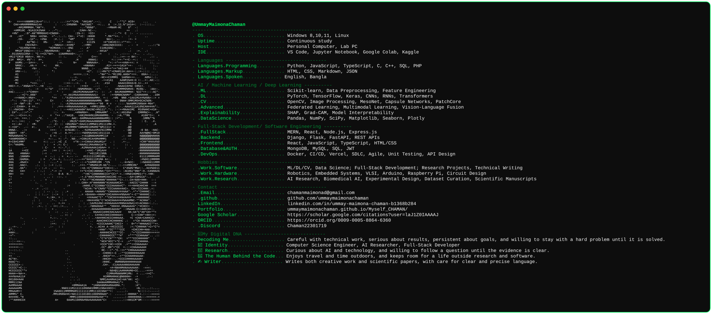
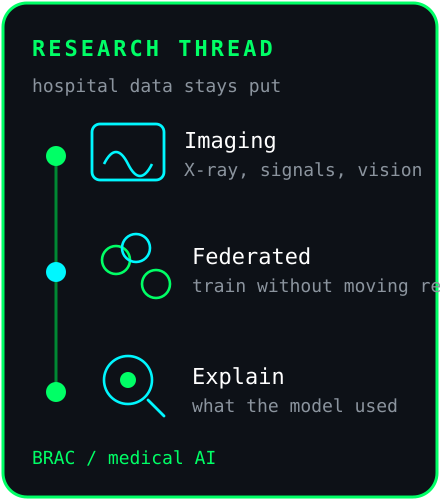

  

<h1 align="center">Hi 👋, I'm Ummay Maimona Chaman</h1>

<h3 align="center">AI research, machine learning, deep learning, robotics, and web development</h3>

  

  

## About Me

<table>
  <tr>
    <td width="70%" valign="top">
      Undergraduate researcher and software engineer at <strong>BRAC University</strong> (B.Sc. in Computer Science and Engineering, finishing September 2026), Dhaka. I work on trustworthy, human-centered medical AI, and on the software around it, including agentic research workflows at <a href="https://moncho.ai/">Moncho.ai</a>.
      <ul>
        <li>🔭 Currently working on <strong>Trustworthy and Human-Centered AI for Healthcare</strong>, with a focus on <strong>federated learning, multimodal AI, medical image analysis, explainable AI (XAI), vision-language models (VLMs), clinical decision support, LLM-based agents, AI evaluation and calibration, and AI-driven biomedical data analysis.</strong></li>
        <li>🌱 Currently learning <strong>large language models (LLMs), retrieval-augmented generation (RAG), agentic AI, AI agents, LLM orchestration, prompt engineering, tool-using agents, and AI evaluation.</strong></li>
        <li>👨‍💻 Projects: <a href="https://ummaymaimonachaman.github.io/Myself_CHAMAN/">Project Portfolio</a></li>
        <li>🔬 Research: <a href="https://ummaymaimonachaman.github.io/UMChaman_Portfolio/">Research Portfolio</a></li>
        <li>💬 Ask me about <strong>AI research, LLMs, RAG, AI agents, robotics, and full-stack development</strong></li>
        <li>🎓 <a href="https://scholar.google.com/citations?user=laJ1Z0IAAAAJ&hl=en">Google Scholar</a> · <a href="https://orcid.org/0009-0005-8864-6360">ORCID 0009-0005-8864-6360</a></li>
        <li>📫 Email: <strong><a href="mailto:chamanmaimonad@gmail.com">chamanmaimonad@gmail.com</a></strong></li>
      </ul>
    </td>
    <td width="30%" valign="top" align="right">
      
        
      
    </td>
  </tr>
</table>

---

## Connect With Me

  
  
  
  
  
  
  
  

---

## Competitive Coding Profiles

  
  
  
  
  
  

---

## Programming Languages

  
  
  
  
  
  
  

---

## Machine Learning and AI

  
  
  
  
  
  
  
  

### Specialization

- Convolutional neural networks and deep learning
- Recurrent neural networks
- Anomaly detection (PatchCore)
- Grad-CAM
- Computer vision

---

## Web Development

  
  
  
  
  
  
  

---

## Databases

  
  
  

---

## Robotics and Embedded Systems

  
  
  

---

## Tools and Development

  
  
  
  
  
  
  

---

## Design and Documentation

  
  
  
  

---

## GitHub Contribution Graph

<picture>
  <source media="(prefers-color-scheme: dark)" srcset="https://raw.githubusercontent.com/ummaymaimonachaman/ummaymaimonachaman/output/pacman-contribution-graph-dark.svg">
  <source media="(prefers-color-scheme: light)" srcset="https://raw.githubusercontent.com/ummaymaimonachaman/ummaymaimonachaman/output/pacman-contribution-graph.svg">
  
</picture>

---

## GitHub Activity

  

  
  

  

